<picture>
  <source media="(max-width: 650px)" srcset="assets/banner-mobile.svg">
  
</picture>

<picture>
  <source media="(max-width: 650px)" srcset="assets/about-note-mobile.svg">
  
</picture>

   
  

 

## GitHub snapshot

<picture>
  <source media="(max-width: 650px)" srcset="assets/github-snapshot-mobile.svg">
  
</picture>

## Selected projects

- [**desktop-tutorial**](https://github.com/xiaocuan221/desktop-tutorial) — 在 GitHub 上迈出的第一步，之后的好东西都会放进来。
